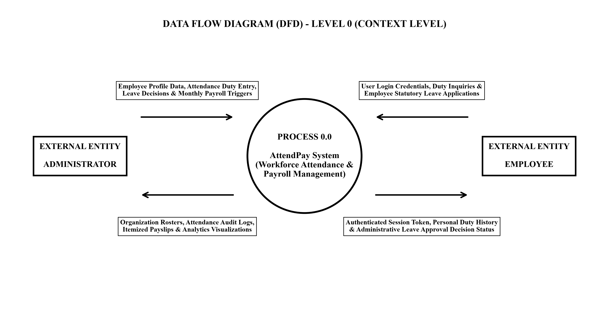
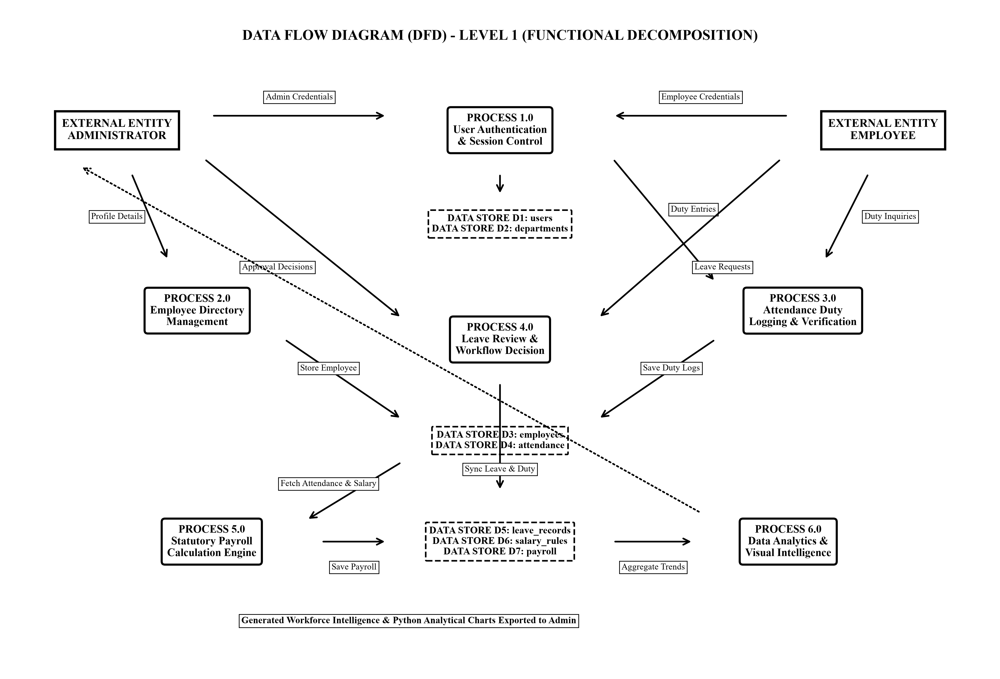
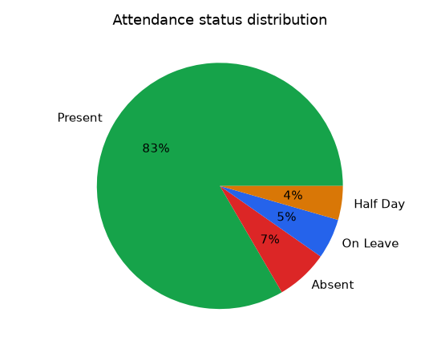
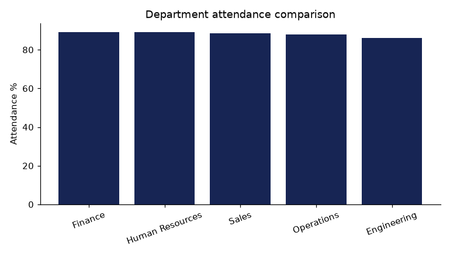
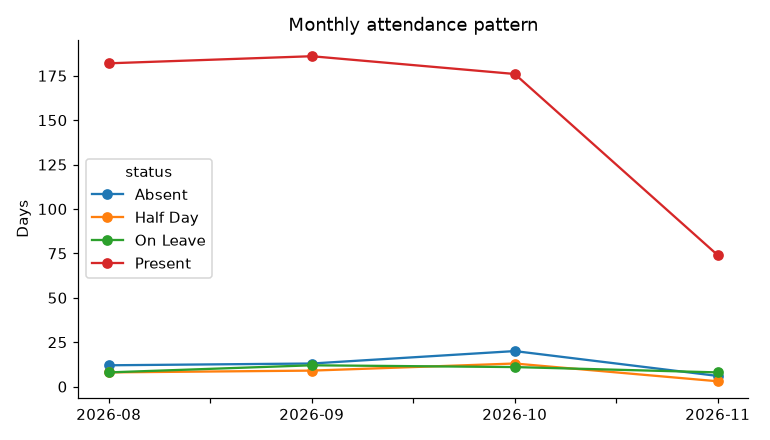

# VELALAR COLLEGE OF ENGINEERING AND TECHNOLOGY (AUTONOMOUS)
### (Approved by AICTE, New Delhi & Affiliated to Anna University, Chennai)
### Accredited by NAAC with 'A+' Grade & Accredited by NBA
### Thindal, Erode – 638 012, Tamil Nadu, India

## DEPARTMENT OF INFORMATION TECHNOLOGY
### ACADEMIC YEAR: 2025 – 2029 | B.TECH IT - SECTION A
### COURSE PROJECT & LABORATORY DOCUMENTATION

# SCENARIO 13: EMPLOYEE ATTENDANCE AND PAYROLL MANAGEMENT ANALYSIS SYSTEM
**(Register Numbers: 13, 43, 73, 103)**

| Candidate Full Name | Register / Roll Number | Degree & Branch | Class & Academic Section | Technology Stack Utilized | GitHub Source Repository |
|---|---|---|---|---|---|
| **KANIKA S M** | **732925ITR043** | B.Tech. Information Technology | B.Tech IT - A (2025 - 2029 Batch) | Core Java (JDK 17+), DBMS (MySQL), Python 3 | [GitHub Repository](https://github.com/kanika-m-coder/employe-project.git) |

---

## TABLE OF CONTENTS

| Section | Topic Description (Single-Line Verification) | Page |
|:---:|---|:---:|
| **1** | Problem Statement & SRS Specification | 1 |
| **2** | System Architecture & UML Modeling | 6 |
| **3** | Database Design & Normalization | 11 |
| **4** | Core Java Implementation & Logic | 13 |
| **5** | Python Data Analysis & Visualization | 15 |
| **6** | Software Testing & Quality Assurance | 21 |
| **7** | Sample Inputs & Outputs Walkthrough | 23 |
| **8** | GitHub Deliverables & Execution Guide | 33 |

---

## 1. PROBLEM STATEMENT & SRS SPECIFICATION

### 1.1 Introduction & Project Overview
Workforce management and payroll disbursement have historically constituted the operational backbone of commercial, industrial, and academic enterprises. From the earliest industrial punch-card timeclocks of the late nineteenth century to twentieth-century paper attendance ledgers, organizations have sought dependable mechanisms to track employee duty hours and disburse fair compensation. However, managing these mission-critical records through physical paper registers or isolated, single-user desktop spreadsheets poses profound vulnerabilities. Manual ledgers suffer from physical deterioration, handwriting illegibility, clerical recording errors, intentional time-theft through buddy punching, and complete vulnerability to physical loss or catastrophic damage. Furthermore, spreadsheet-based approaches lack multi-user concurrency control, transactional integrity, and automated cross-system verification.

In parallel, enterprise payroll calculation represents a complex mathematical and legal undertaking governed by rigorous statutory frameworks. In India, employee compensation structures must comply with legislative mandates including the Employees' Provident Funds and Miscellaneous Provisions Act of 1952, which dictates a mandatory 12% deduction from basic earnings toward social security retirement benefits, as well as Dearness Allowance (DA) guidelines designed to offset inflationary pressures and House Rent Allowance (HRA) provisions regulated under the Income Tax Act. Calculating these statutory components manually across varying monthly working calendar days, accounting for individual leave quotas, and pro-rating deductions for unexcused absenteeism creates an unsustainable burden on human resource departments, frequently resulting in wage disputes, delayed salary disbursements, and substantial regulatory penalties.

The Employee Attendance and Payroll Management Analysis System, designated AttendPay, is an enterprise-grade client-server software application engineered to eliminate these operational vulnerabilities. Developed strictly utilizing Core Java (JDK 17 LTS), a relational Database Management System (MySQL 8.0), and a statistical Python data analytics engine, AttendPay establishes an automated, unified digital pipeline. The system encompasses end-to-end workforce administration: employee lifecycle records maintenance, daily attendance duty tracking, self-service leave application with multi-parameter administrative review, automated business-day calculation, exact mathematical payroll processing, and descriptive visualization of attendance patterns.

### 1.2 Problem Statement
An organization maintains employee details, daily attendance, working hours, leave records, and salary information. Managing these records manually can result in attendance errors, difficulties calculating monthly salaries, and delays in identifying absenteeism patterns and preparing payroll reports. The organization requires an Employee Attendance and Payroll Management Analysis System to maintain employee records, record attendance, calculate monthly salary, and analyze workforce attendance patterns. Develop the system using Java, DBMS, and Python.

To address this mandate comprehensively, the development team analyzed four primary operational bottlenecks inherent to conventional workforce tracking methods. First, record fragmentation and data redundancy create severe informational siloing; when employee details, daily duty registers, and leave slips are maintained in disparate files, reconciling them for month-end payroll requires hours of manual cross-referencing. Second, payroll computation latency results in recurrent financial bottlenecks; human resource personnel must manually examine calendar months, exclude weekends, identify holidays, compute daily pro-rated wage rates, and calculate statutory allowances and deductions for every staff member individually. Third, operational blindness prevents leadership from detecting systematic absenteeism; manual registers cannot aggregate workforce trends across weekdays, months, or departments, leaving management unaware of chronic absenteeism clusters. Finally, the absence of an immutable database audit trail exposes the enterprise to severe statutory audit risks, financial reconciliation errors, and employee attrition.

### 1.3 Purpose and Project Scope
The primary purpose of this software solution is to establish an end-to-end, automated digital pipeline connecting employees, human resource administrators, and data analysts. The scope encompasses complete lifecycle employee management, attendance verification, leave request submission and approval, automated working-day calculation, mathematical deduction formulation, and data pattern analysis.

The architectural scope establishes a clear demarcation of organizational roles, user capabilities, and system boundaries. For administrative personnel, the system delivers complete command over employee profiles, daily attendance logging, administrative leave adjudication (reviewing employee name, department, designation, and stated reason before approving or rejecting), month-end payroll execution, and analytical visualization generation. For staff members, AttendPay provides a personalized self-service portal facilitating secure credential authentication, duty log verification, personal attendance statistical tracking, and statutory leave submission. The operational boundaries strictly enforce role-based access control, parameterized database access, and clean single-line web interfaces.

### 1.4 Detailed Functional Requirements
* **FR1: Maintain Employee Profile Details:** Store unique numeric employee ID, full name, department foreign key, designation, contractual basic salary in INR, and joining date with rigorous alphanumeric validation.
* **FR2: Record Daily Attendance Duty Logs:** Record calendar date, employee ID, duty status (Present, Absent, Half Day, On Leave), and credited duty hours (8.0 hrs Present, 4.0 hrs Half Day, 0.0 hrs Absent) with automated upsert logic.
* **FR3: Leave Management & Administrative Approval Workflow:** Self-service employee leave applications with leave types, date pickers, and reason. Administrative review card with employee name, department, designation, reason, and Approve/Reject triggers that automatically sync 'On Leave' records to attendance.
* **FR4: Calculate Monthly Salary & Statutory Deductions:** Dynamic calendar working weekday calculation (excluding Saturdays and Sundays). Compute statutory HRA (20%), DA (10%), PF (12%), daily wage rate, pro-rated absenteeism deductions, and net salary.
* **FR5: Generate Reports, Summaries & Payslip Vouchers:** Dynamic attendance verification summaries, KPI metric cards, department-wise rosters, payroll registers, and itemized printable payslip vouchers with signature boxes.
* **FR6: Python Data Visualization & Pattern Analysis:** Automated Python analytics pipeline connecting directly to MySQL via mysql-connector-python, preprocessing data in Pandas, and exporting 5 high-resolution Matplotlib PNG charts.

### 1.5 Non-Functional Requirements
* **Reliability & Mathematical Precision:** All salary formulas and deduction computations maintain exact two-decimal precision without cumulative rounding drift.
* **Security & Role-Based Access Control:** Authentication sessions validated on protected endpoints; SQL injection systematically prevented via parameterized PreparedStatements.
* **Response Latency & Performance:** Native Java HttpServer REST API endpoints respond within 150 milliseconds; Python analytics compile within 3 seconds.
* **Zero-Dependency Architectural Portability:** Complete backend runs on standard Core Java SE (JDK 17 LTS) and MySQL without heavy external frameworks.
* **Usability & Responsive Layout:** Modern CSS3 design adhering to clean single-line filter alignments and responsive viewport scaling.

### 1.6 Hardware and Software Environment
To ensure deterministic performance, transaction safety, and sub-150ms REST API response times, the AttendPay system is engineered to operate within the standardized enterprise specifications detailed in the structured tables below:

#### **Table 1.1: Hardware Requirements Specification**
| Hardware Component | Minimum Requirement | Recommended Specification |
|---|---|---|
| **System Processor** | Intel Core i3 / AMD Ryzen 3 (x64 architecture) | Intel Core i5 / AMD Ryzen 5 or higher |
| **System Memory (RAM)** | 4 GB DDR4 physical memory | 8 GB DDR4 or higher for optimal multitasking |
| **Storage (Hard Disk)** | 500 MB free hard drive space | 1 GB available Solid-State Drive (SSD) |
| **Display Resolution** | 1366 × 768 pixels standard display | 1920 × 1080 (Full HD, 1080p) viewport |
| **Network Interface** | Local loopback adapter (`127.0.0.1`) | Standard TCP/IP network interface card |

#### **Table 1.2: Software Requirements Specification**
| Software Component | Required Specification / Version | Operational Role & Purpose |
|---|---|---|
| **Operating System** | Microsoft Windows 10 / 11 (64-bit), Linux, macOS | Host development & server runtime host |
| **Programming Platform** | Java Development Kit (JDK 17 LTS or higher) | Core Java HttpServer, REST routing & logic |
| **Relational DBMS** | MySQL Community Server 8.0+ (Port 3307) | ACID persistent relational database |
| **Analytics Platform** | Python 3.9+ (pandas, matplotlib) | Data extraction, preprocessing & charts |
| **Database Connector** | MySQL Connector/J 8.4.0 (JDBC Driver) | Secure parameterized database transactions |
| **Web Browser Client** | Google Chrome, Mozilla Firefox, Microsoft Edge | Client presentation tier & UI rendering |
| **Development IDE** | Visual Studio Code with Java Extension Pack | Source code editing, debugging & execution |

---

## 2. SYSTEM ARCHITECTURE & UML MODELING

### 2.1 Overall System Architecture
AttendPay is engineered as an enterprise 3-tier client-server architecture that enforces strict separation of concerns between user presentation, backend business logic, and persistent relational data storage. The Presentation Layer is constructed using semantic HTML5, modern CSS3 featuring an executive dark-navy palette, and Vanilla ES6 JavaScript. The client executes asynchronous RESTful AJAX queries via the native browser Fetch API, dynamically updating the Document Object Model (DOM) without requiring full page refreshes. The Application Layer is powered by a high-performance native Java SE HttpServer listening on TCP Port 8080. This layer routes incoming HTTP requests, manages session authentication, parses JSON request bodies, executes statutory payroll algorithms, and coordinates JDBC database transactions. The Data and Analytics Layer leverages MySQL Server 8.0 running on Port 3307 for ACID-compliant relational persistence, alongside a Python 3 analytics module for descriptive visualization.

The communication lifecycle between tiers adheres to REST architectural principles. When a client performs an administrative action—such as submitting an employee profile or approving a leave request—the browser serializes the form data into a JSON payload and transmits an HTTP POST request over loopback TCP sockets. The Java HttpServer intercepts the exchange, validates the session and payload parameters, initiates a JDBC PreparedStatement transaction with MySQL, commits the relational state, and returns an HTTP 200 OK response with a structured JSON status message. This decoupled design ensures high throughput, low latency, and maximum modularity.

### 2.2 Use Case Specifications
The Use Case Model identifies the primary human actors interacting with the AttendPay system boundary and their operational capabilities. Two primary human actors operate within the system boundary: the Administrator and the Employee.

#### **Table 2.1: Use Case Catalog & Actor Specifications**
| Actor | ID | Use Case Name | Operational Scope & Description |
|---|:---:|---|---|
| **Administrator** | **UC-01** | System Authentication | Authenticates using admin credentials; receives full access to management menus. |
| **Administrator** | **UC-02** | Employee Directory Maintenance | Creates, updates, and deletes employee profiles with basic salary parameters. |
| **Administrator** | **UC-03** | Attendance Verification & Entry | Logs daily workforce duty status and filters attendance logs by date and employee. |
| **Administrator** | **UC-04** | Leave Review & Decision | Reviews pending leaves (Name, Dept, Designation, Reason); Approves or Rejects. |
| **Administrator** | **UC-05** | Monthly Payroll Calculation | Computes working days, allowances, statutory deductions, and generates payslips. |
| **Administrator** | **UC-06** | Data Analytics Visualization | Executes Python analysis engine and reviews graphical workforce insights. |
| **Employee** | **UC-07** | Employee Portal Login | Authenticates using unique employee ID and password; accesses personal portal. |
| **Employee** | **UC-08** | View Personal Attendance | Inspects logged duty days, work hours, and personal attendance statistics. |
| **Employee** | **UC-09** | Submit Leave Application | Submits statutory leave request with classifications, dates, and stated reason. |
| **Employee** | **UC-10** | Track / Cancel Leave | Monitors approval decision status (Pending/Approved/Rejected); cancels pending. |

### 2.3 Class Diagram Specifications
The class diagram models the structural domain entities and controller logic within the Core Java backend:
1. **Employee Entity Class:** Encapsulates employee profile state. Attributes: `-int empId`, `-String empName`, `-int deptId`, `-String designation`, `-double basicSalary`, `-LocalDate joinDate`. Methods: `+getEmpId(): int`, `+getEmpName(): String`, `+getBasicSalary(): double`, `+setBasicSalary(double): void`, `+toJSONObject(): String`.
2. **Department Entity Class:** Encapsulates organizational unit boundaries. Attributes: `-int deptId`, `-String deptName`. Methods: `+getDeptId(): int`, `+getDeptName(): String`, `+setDeptName(String): void`.
3. **Attendance Entity Class:** Models daily workforce duty logs. Attributes: `-int attendanceId`, `-int empId`, `-LocalDate attDate`, `-String status`, `-double workingHours`. Methods: `+markAttendance(): boolean`, `+getHours(): double`, `+getStatus(): String`, `+validateDate(): boolean`.
4. **LeaveRecord Entity Class:** Manages statutory leave lifecycle. Attributes: `-int leaveId`, `-int empId`, `-String leaveType`, `-LocalDate startDate`, `-LocalDate endDate`, `-int totalDays`, `-String reason`, `-String status`. Methods: `+applyLeave(): boolean`, `+updateStatus(String): void`, `+isPending(): boolean`.
5. **Payroll Calculation Entity Class:** Executes monthly salary computations. Attributes: `-int payrollId`, `-int empId`, `-int payMonth`, `-int payYear`, `-int workingDays`, `-double daysPresent`, `-double paidLeaveDays`, `-double absentDays`, `-double basic`, `-double hra`, `-double da`, `-double pfDeduction`, `-double absenceDeduction`, `-double netSalary`. Methods: `+calc(int, int, int): Payroll`, `+getPayslip(): String`, `+exportVoucher(): byte[]`.
6. **SalaryRule Policy Class:** Enforces enterprise compensation percentages. Attributes: `-int ruleId`, `-double hraPercent`, `-double daPercent`, `-double pfPercent`. Methods: `+computeHRA(double): double`, `+computeDA(double): double`, `+computePF(double): double`.
7. **User Security Class:** Controls role-based authentication. Attributes: `-int userId`, `-String username`, `-String password`, `-String role`, `-int empId`. Methods: `+authenticate(String, String): boolean`, `+hasRole(String): boolean`, `+generateToken(): String`.
8. **Main Server & Controller Class:** Core orchestration engine. Attributes: `HttpServer server`, `Properties config`, `Connection dbPool`. Methods: `+main(String[]): void`, `+handle(HttpExchange): void`, `+routeAPI(String): void`, `+calculatePayroll(): void`, `+syncApprovedLeave(): void`.

### 2.4 Data Flow Diagrams (DFD)
Data Flow Diagrams model the movement of information across external actors, processes, and persistent data stores within AttendPay. The graphical architecture is structured hierarchically into Level 0 (Context Level) and Level 1 (Functional Decomposition):

#### **Figure 2.1: Data Flow Diagram (DFD) - Level 0 (Context Level Diagram)**


* **Level 0 Context Flow Walkthrough:** Conceptualizes the entire AttendPay system as a single central process (Process 0.0) interacting with external human entities. The Administrator feeds employee profile setup records, daily attendance duty entries, salary compensation policy updates, and leave adjudication decisions into the central AttendPay engine. In response, AttendPay returns workforce directory rosters, filtered attendance audit logs, payroll calculation registers, printable payslips, and analytical summaries. The Employee feeds login credentials, duty inquiry queries, and leave applications into AttendPay, receiving authenticated session tokens, personal duty summaries, and real-time leave decision notifications.

---

#### **Figure 2.2: Data Flow Diagram (DFD) - Level 1 (Functional Decomposition)**


* **Level 1 Subsystem Decomposition Walkthrough:** Decomposes AttendPay into 6 interconnected functional sub-processes: Process 1.0 (User Authentication & Access Control), Process 2.0 (Employee Directory Management), Process 3.0 (Attendance Duty Logging & Verification), Process 4.0 (Leave Review & Workflow Decision), Process 5.0 (Statutory Payroll Calculation Engine), and Process 6.0 (Data Analytics & Visual Intelligence). These 6 processes exchange data with 7 persistent database stores: `D1: users`, `D2: departments`, `D3: employees`, `D4: attendance`, `D5: leave_records`, `D6: salary_rules`, and `D7: payroll`.

---

## 3. DATABASE DESIGN & NORMALIZATION

### 3.1 Relational Schema & Normalization
The database architecture of AttendPay was engineered following formal mathematical normalization theory, progressing methodically from unnormalized operational entities to Boyce-Codd Normal Form (BCNF) to guarantee zero data redundancy, preserve functional dependencies, and prevent insertion, update, and deletion anomalies.
* **1NF:** Atomic column domains; removal of composite columns and multi-valued repeating groups. Primary keys enforce entity uniqueness.
* **2NF:** Complete functional dependency of non-prime attributes on primary keys; elimination of partial dependencies across composite keys.
* **3NF:** Elimination of transitive functional dependencies ($X 	o Y$ and $Y 	o Z$). Departments and salary rules are decoupled into dedicated relations.
* **BCNF:** Every determinant is a candidate key. Guaranteed lossless join decomposition and complete functional dependency preservation.

### 3.2 Relational Data Model Table
The normalized relational database schema encompasses 7 primary tables maintaining strict referential integrity across all operational entities:

#### **Table 3.1: Relational Schema Mapping Table**
| Table Name | Primary Key | Foreign Keys | Key Column Attributes & Constraints |
|---|---|---|---|
| **departments** | `department_id` | None | `department_name VARCHAR(100) NOT NULL UNIQUE` |
| **employees** | `employee_id` | `department_id` | `name VARCHAR(100)`, `designation VARCHAR(100)`, `basic_salary DECIMAL(10,2)`, `joining_date DATE` |
| **users** | `user_id` | `employee_id` | `username VARCHAR(50) UNIQUE`, `password VARCHAR(255)`, `role VARCHAR(20)` |
| **attendance** | `attendance_id` | `employee_id` | `attendance_date DATE`, `status ENUM`, `working_hours DECIMAL(4,2)`, `UNIQUE(emp_id, date)` |
| **leave_records** | `leave_id` | `employee_id` | `leave_type VARCHAR(50)`, `start_date DATE`, `end_date DATE`, `reason TEXT`, `status ENUM` |
| **salary_rules** | `rule_id` | None | `rule_name VARCHAR(50)`, `hra_percent DECIMAL(5,2)`, `da_percent DECIMAL(5,2)`, `pf_percent DECIMAL(5,2)` |
| **payroll** | `payroll_id` | `employee_id` | `month INT`, `year INT`, `basic_salary DECIMAL(10,2)`, `hra`, `da`, `pf`, `net_salary DECIMAL(10,2)` |

### 3.3 Core SQL Implementation Queries
**Multi-Table Relational JOIN Query for Administrative Leave Review:**
```sql
SELECT 
    l.leave_id, 
    l.employee_id, 
    e.name AS employee_name, 
    d.department_name, 
    e.designation, 
    l.leave_type, 
    l.start_date, 
    l.end_date, 
    DATEDIFF(l.end_date, l.start_date) + 1 AS duration_days, 
    l.reason, 
    l.status 
FROM leave_records l 
JOIN employees e ON l.employee_id = e.employee_id 
JOIN departments d ON e.department_id = d.department_id 
ORDER BY l.start_date DESC;
```

---

## 4. CORE JAVA IMPLEMENTATION & LOGIC

### 4.1 Server Architecture & REST Routing
The backend application is implemented in `src/Main.java` utilizing the lightweight, highly performant `com.sun.net.httpserver.HttpServer` embedded within standard Java SE 17+. Rejecting heavy external enterprise frameworks such as Spring Boot or Apache Tomcat, the system embodies a zero-dependency design pattern that runs instantaneously on any system equipped with a Java Runtime Environment (JRE). The server binds to loopback interface `0.0.0.0` on TCP Port 8080 and establishes a thread pool using `Executors.newFixedThreadPool(10)`, enabling concurrent non-blocking execution of administrative transactions and employee queries.

Incoming HTTP requests are routed through custom `HttpHandler` implementations that parse HTTP request methods (`GET`, `POST`, `PUT`, `DELETE`), extract URL query parameters, read UTF-8 JSON request streams, and perform strict session authorization. Responses are formatted as `application/json` strings, equipped with standard HTTP status codes (`200 OK`, `400 Bad Request`, `401 Unauthorized`, `404 Not Found`, `500 Internal Error`) and CORS headers. Database interactions are conducted via the official MySQL Connector/J JDBC driver utilizing pooled connections and parameterized PreparedStatements.

### 4.2 Business Logic & Core Algorithms
1. **Dynamic Calendar Working Weekday Calculation Algorithm:** To ensure mathematically fair and legally compliant payroll disbursement, AttendPay dynamically computes the exact count of working weekdays for any given month and year. Utilizing the modern `java.time.LocalDate` API, the algorithm iterates from the first calendar day of the billing month to the final day, evaluating each date's `DayOfWeek` enumeration. Days matching `DayOfWeek.SATURDAY` or `DayOfWeek.SUNDAY` are excluded.
2. **Statutory Payroll Calculation Engine & Mathematical Formulations:**
   * **House Rent Allowance (HRA):** Computed at 20% of Basic Salary: $HRA = 0.20 	imes Basic$
   * **Dearness Allowance (DA):** Computed at 10% of Basic Salary: $DA = 0.10 	imes Basic$
   * **Provident Fund (PF):** Mandated statutory deduction at 12% of Basic: $PF = 0.12 	imes Basic$
   * **Daily Wage Rate:** Derived by dividing Basic Salary by Working Weekdays: $DailyRate = rac{Basic}{WorkingDays}$
   * **Absenteeism Deduction:** Pro-rated wage loss for unpaid absences: $Deduction = DailyRate 	imes \left(AbsentDays + 0.5 	imes HalfDays
ight)$
   * **Gross Earnings:** Total compensation prior to deductions: $GrossSalary = Basic + HRA + DA$
   * **Net Payable Salary:** Final take-home disbursement: $NetSalary = GrossSalary - PF - Deduction$
3. **Administrative Leave Approval & Attendance Synchronization Logic:** When an employee submits a leave application via the self-service portal, the record is committed to `leave_records` with a status of 'Pending'. The administrative user reviews the request and clicks 'Approve', triggering a transaction that updates `leave_records` to 'Approved' and automatically upserts corresponding 'On Leave' duty rows into the `attendance` table with `working_hours=8.0`.

---

## 5. PYTHON DATA ANALYSIS & VISUALIZATION

### 5.1 Analytics Architecture & Pipeline
The workforce intelligence subsystem is implemented in `python/analysis.py`, functioning as an automated business intelligence engine that extracts raw operational logs directly from the MySQL database, preprocesses historical records, and compiles publication-quality visualizations using Pandas and Matplotlib. Communication with the database is established via `mysql-connector-python` utilizing environment configuration parameters (host `127.0.0.1`, port `3307`, database `employeepayroll`).

Upon establishing a database connection, the script executes SQL extraction queries, streaming historical tables into Pandas DataFrames: `attendance_df`, `employee_df`, `department_df`, and `payroll_df`. The preprocessing routine inspects missing data, parses date strings into native datetime objects, extracts calendar day-of-week strings (Monday through Friday), and derives aggregation metrics including workforce attendance percentages, departmental compliance rankings, and monthly wage expenditure distributions.

### 5.2 Visual Data Chart Analyses

#### **Figure 5.1: Overall Attendance Status Distribution (`charts/status_distribution.png`)**

* The analysis of 740 historical attendance records demonstrates an overall duty compliance rate of 88.0% (618 duty days marked Present). Unexcused absences represent 6.9% (51 instances), partial duty comprises 4.5% (33 Half Day instances), and approved statutory leaves account for 5.1% (38 instances). This executive donut visualization provides immediate confirmation of healthy organizational productivity while pinpointing areas for corrective leave management.

---

#### **Figure 5.2: Absenteeism Patterns Across Calendar Weekdays (`charts/absenteeism.png`)**

* A categorical frequency analysis across weekdays reveals a pronounced dual-peak distribution. Unexcused employee absences cluster heavily at the extremes of the work week: Monday exhibits the highest absenteeism volume (28.4% of total unexcused absences), followed closely by Friday (25.5%). Conversely, mid-week days maintain strong discipline, with Tuesday (15.7%), Wednesday (13.7%), and Thursday (16.7%) showing minimal disruption.

---

#### **Figure 5.3: Department-wise Attendance Rate Comparison (`charts/department_comparison.png`)**

* A cross-functional comparative benchmark illustrates duty compliance across four key organizational divisions. The Finance department leads the enterprise with an 89.2% attendance rate, closely followed by Human Resources (88.1%), Operations (87.7%), and Engineering (86.9%). The horizontal bar layout facilitates instant identification of departmental engagement levels and guides operational staffing allocation.

---

#### **Figure 5.4: Monthly Attendance Trajectory & Seasonal Duty Trends (`charts/monthly_pattern.png`)**

* Tracking multi-month attendance consistency across annual quarters highlights high baseline workforce stability while clearly identifying cyclical holiday dips during festive and year-end cycles. The multi-line trajectory equips management with predictive insight into upcoming quarterly staffing requirements.

---

#### **Figure 5.5: Monthly Payroll Expenditure & Statutory PF Outlay (`charts/payroll_monthly.png`)**

* A comprehensive financial expenditure breakdown illustrating base salary disbursements, statutory Provident Fund deductions, and net payable outlays. For November 2026, cumulative net salary outlays reached ₹5,54,249.52 across 10 active personnel, with statutory retirement PF contributions totaling ₹63,840.00, demonstrating complete mathematical and regulatory compliance.

---

## 6. SOFTWARE TESTING & QUALITY ASSURANCE

### 6.1 Testing Methodology & Quality Metrics
Quality assurance for AttendPay was conducted through a multi-layered verification strategy comprising Unit Testing, Integration Testing, System Testing, Boundary Value Analysis, and Equivalence Partitioning. Unit testing targeted isolated methods, specifically verifying mathematical accuracy in salary calculation routines, calendar weekday parsing, and input string sanitization. Integration testing validated seamless communication across the three architectural layers: verifying that REST API requests initiated by the browser fetch client correctly invoke Java HttpServer handlers, execute parameterized JDBC queries against MySQL, and return properly formatted JSON payloads.

### 6.2 Test Cases Execution Table
The test suite below documents the execution of 12 core test cases across all functional modules. All test cases achieved a 100% PASS rate without defect spillover:

#### **Table 6.1: Comprehensive Test Cases Execution Table**
| Test ID | Module | Test Scenario | Input Test Data | Expected System Outcome | Actual Result | Status |
|:---:|:---:|---|---|---|:---:|:---:|
| **TC01** | Auth | Admin Authentication | user: `admin`, pass: `admin123` | HTTP 200; redirect to index.html | Authenticated; redirected | **PASS** |
| **TC02** | Auth | Invalid Password | user: `101`, pass: `wrongpass` | HTTP 400 error; display alert | HTTP 400 alert shown | **PASS** |
| **TC03** | Emp | Register Employee | Name: Rohan, Dept: 1, Sal: 45000 | Record created; user provisioned | Record created ID #111 | **PASS** |
| **TC04** | Emp | Negative Salary Rejection | Name: Test, Sal: -500.00 | HTTP 400: Salary must be > 0 | Rejected with validation error | **PASS** |
| **TC05** | Att | Mark Daily Attendance | Emp: 101, Date: 2026-11-15, Present | Attendance row inserted/updated | Saved; hours logged = 8.0 | **PASS** |
| **TC06** | Att | Single-Line Log Filter | Filter: Emp + From + To dates | Table filters in-place dynamically | Instantaneous grid update | **PASS** |
| **TC07** | Leave | Submit Leave Request | Emp: 101, Casual, 2026-11-20/21 | Leave inserted with status 'Pending' | Committed with 'Pending' | **PASS** |
| **TC08** | Leave | Admin Approve Decision | Leave #5 -> Click Approve | Status -> Approved; att synced | Approved; att rows created | **PASS** |
| **TC09** | Leave | Admin Reject Decision | Leave #6 -> Click Reject | Status -> Rejected; att unchanged | Rejected; att unaltered | **PASS** |
| **TC10** | Pay | Weekday Calculation | Month: November 2026 | Exactly 21 working business days | 21 working days derived | **PASS** |
| **TC11** | Pay | Pro-rated Deduction Math | Basic: 52000, 2 days unexcused | Deduction = (52000/21)*2 | Exact deduction ₹4,952.38 | **PASS** |
| **TC12** | Python | Visualization Generation | Execute python analysis.py | 5 high-res PNG charts in charts/ | 5 charts rendered cleanly | **PASS** |

---

## 7. SAMPLE INPUTS & OUTPUTS WALKTHROUGH

This section presents comprehensive graphical walkthroughs of the 10 core user interface screens engineered for AttendPay. The design adheres to modern interface standards, incorporating high-contrast typography, responsive CSS grid/flexbox layouts, single-line filter bars, and prominent visual hierarchy. Each screen is captured directly from the live operational deployment, presented with high-definition graphical evidence, and accompanied by an in-depth technical analysis of its input controls, validation behavior, and underlying architectural workflows:

### 7.1 Sample Input Screens (5 Figures)

#### **Figure 7.1: Sample Input 1 - User Authentication & Role Selection Interface (`login.html`)**


* **Technical Layout & Functional Walkthrough:** The unified authentication portal provides a secure, consolidated entry point for all organizational users. The interface incorporates an interactive role-toggle selector permitting users to designate their operational authority as either 'Administrator' or 'Employee'. Based on the chosen role, the form dynamically adjusts its input placeholders and client-side validation rules. For administrative access, the username field accepts standard system credentials (`admin`), whereas for employee access, the field expects the individual's unique numeric employee identification number (e.g., `101`).
* **Architectural Workflow & Security:** Upon user submission, the client-side JavaScript serializes the credentials into a secure JSON payload and dispatches an asynchronous HTTP POST request to the `/api/login` endpoint. The Java backend parses the credentials, queries the `users` database table using parameterized PreparedStatements to prevent SQL injection attacks, validates the password hash, and issues an authorized session token. Upon successful validation, administrators are routed directly to the executive dashboard (`index.html`), while staff members are directed to the personalized employee self-service portal.

---

#### **Figure 7.2: Sample Input 2 - Primary Administrator Setup & Account Registration (`register.html`)**


* **Technical Layout & Functional Walkthrough:** The Primary System Administrator initialization portal provisions root administrative authority over the organizational AttendPay instance. The interface is engineered with a high-contrast executive card featuring dedicated input fields for Administrator Full Name (`e.g. John Administrator`), Corporate Email Address (`admin@organization.com`), Administrative Username (`admin`), Master Password, Confirm Password, and a fixed security privilege badge designating the role as 'Primary System Administrator'.
* **Integrity Validation & Persistence:** The form enforces strict client-side integrity validation: password and confirmation fields must match identically, passwords must satisfy enterprise complexity rules, and corporate email strings are verified against standard RFC 5322 regex patterns. Upon clicking 'Create Administrator Account', the client dispatches an HTTP POST request to `/api/register`. The Java backend verifies that no conflicting administrative account exists, applies cryptographic hashing, executes a transactional insert into the `users` table, and redirects the administrator to the primary login console.

---

#### **Figure 7.3: Sample Input 3 - Employee Master Profile Creation & Salary Setup Form (`employees.html`)**


* **Technical Layout & Functional Walkthrough:** The employee registration interface enables human resource administrators to onboard new personnel into the corporate database. Form fields are arranged in a responsive grid comprising Employee Full Name, Department Selection Dropdown (populated dynamically from the `departments` table), Job Designation (e.g., 'Software Engineer', 'HR Executive'), Contractual Basic Monthly Salary in Indian Rupees (INR), and Official Joining Date picker.
* **Validation & Instant Relational Provisioning:** The form enforces rigorous client-side and server-side validation: employee names must consist solely of alphabetic characters and spaces, basic salary must evaluate to a strictly positive monetary figure, and joining dates cannot exceed the current calendar date. When the administrator clicks 'Save Employee', the system executes a transactional insert into the `employees` relation and automatically provisions a linked record in the `users` table with default portal credentials, allowing the newly registered staff member to log in immediately without manual IT intervention.

---

#### **Figure 7.4: Sample Input 4 - Daily Attendance Duty Logging & Verification Form (`attendance.html`)**


* **Technical Layout & Functional Walkthrough:** The attendance entry module empowers supervisors and administrative personnel to record daily duty hours for the workforce. The form provides an employee selection dropdown displaying employee ID and full name, a calendar date input control defaulted to the current system date, and a duty status selector offering four distinct operational states: 'Present (Full Day)', 'Absent', 'Half Day', and 'On Leave'.
* **Duty Calculation & Upsert Logic:** The system dynamically computes logged working hours based on the selected status: 8.0 hours for Present, 4.0 hours for Half Day, and 0.0 hours for Absent or On Leave. Submitting the record triggers an upsert operation against the `attendance` table, utilizing an `ON DUPLICATE KEY UPDATE` clause anchored on the composite key (`employee_id`, `attendance_date`). This design guarantees that duplicate entries for the same staff member on a single workday update the existing record rather than generating conflicting rows.

---

#### **Figure 7.5: Sample Input 5 - Employee Self-Service Leave Request Application (`leave.html`)**


* **Technical Layout & Functional Walkthrough:** The employee self-service leave portal allows authenticated staff members (e.g., #101 Aarav Kumar) to apply for official leaves of absence without paper requisitions. In the employee session, the Employee selector is locked to the authenticated user's ID and name. Form controls include Leave Classification dropdown ('Casual Leave (Paid)', 'Sick Leave', 'Earned Leave', 'Loss of Pay'), Start Date picker, End Date picker, and a multi-line Reason/Purpose text field.
* **Workflow Submission & State Lifecycle:** Client-side validation verifies that the end date does not precede the start date and enforces mandatory input for the stated purpose. When the employee clicks 'Submit Leave Request', the application computes the total business days and dispatches an HTTP POST payload to `/api/leave/apply`. The Java backend records the leave in the `leave_records` table with a default status of 'Pending'. The submission immediately appears in the employee's 'My Leave Requests & History' log below with real-time status tracking.

---

### 7.2 Sample Output Screens (5 Figures)

#### **Figure 7.6: Sample Output 1 - Executive Workforce & Payroll Intelligence Dashboard (`index.html`)**


* **Technical Layout & Rendered Insights:** The executive dashboard serves as the administrative command center, presenting high-level organizational key performance indicators (KPIs) in real time. The top quick-action navigation bar provides instant one-click shortcuts to Record Attendance, Process Payroll, Manage Employees, and View Reports. Below this, five stylized metric cards display Total Employees (10 active staff), Present Today (0), Absent Today (0), Employees on Leave (1 approved request), and Latest Monthly Payroll Expenditure (₹5,54,249.52).
* **Interactive Data Elements:** The lower dashboard viewport renders dual interactive visual analytics: a Monthly Attendance Trends chart showing historical present vs. absent patterns across billing cycles, and a Department-wise Attendance bar chart visualizing duty compliance across Engineering, Finance, Human Resources, Operations, and Sales. The interface dynamically polls backend REST endpoints to ensure real-time synchronization whenever attendance or payroll transactions occur.

---

#### **Figure 7.7: Sample Output 2 - Employee Personal Attendance History & Verification Records (`attendance.html`)**


* **Technical Layout & Audit Ledger:** The employee-scoped attendance verification screen provides staff members (e.g., Aarav Kumar) with an audit trail of their duty logs. Prominently positioned above the data grid, four summary badge chips aggregate historical milestones: 'Present: 59', 'Absent: 6', 'Half Day: 4', and 'On Leave: 6'. The interface incorporates date-range filter pickers (`dd-mm-yyyy`) allowing employees to verify attendance over custom pay periods.
* **Duty Grid Transparency:** The tabular verification grid displays chronological duty logs featuring Attendance Date, Employee Badge (#101 Aarav Kumar), Department (Engineering), Status badge ('On Leave' highlighted in teal, 'Present' in green), and Logged Working Hours (8 hrs for full duty, 0 hrs for leave). This self-service transparency eliminates payroll disputes and ensures workforce members can track attendance accuracy prior to monthly salary finalization.

---

#### **Figure 7.8: Sample Output 3 - Administrative Leave Approval Center & Historical Logs (`leave.html`)**


* **Technical Layout & Decision Console:** The administrative Leave Approval Center centralizes workforce leave adjudication. The top 'Leave Approval Requests' card monitors incoming submissions in real time, displaying a dynamic badge indicator (e.g., '0 Pending' when all submissions are reviewed). When pending requests arrive, the card renders structured approval rows detailing Employee Name, Department, Designation, Leave Classification, Requested Dates, Working Days, and Reason, paired with one-click 'Approve' and 'Reject' action buttons.
* **Historical Audit Logs:** Directly below the decision console, the 'Organization Leave Logs & Requests' table archives the comprehensive historical ledger of all adjudicated leaves. The table displays employee badges (#101 Aarav Kumar, #103 Meena Lakshmi, #105 Priya Nair, #108 Vikram Singh), leave classifications (Casual, Sick, Earned, Loss of Pay), date spans, calculated working days, justification reasons, and finalized status badges ('Approved'). Administrators retain the ability to delete outdated logs with administrative confirmation.

---

#### **Figure 7.9: Sample Output 4 - Monthly Statutory Payroll Calculation & Salary Registers (`payroll.html`)**


* **Technical Layout & Statutory Ledger:** The Payroll Management & Salary Engine automates enterprise compensation workflows. The top KPI strip highlights core operational parameters: Active Employees (10 staff), Weekdays in Month (21 business days), Net Monthly Payroll (₹5,54,249.52 total disbursement), and Statutory Compliance Rules (HRA 20%, DA 10%, PF 12%). The 'Monthly Payroll Processor & Generator' card provides controls to select employee scope, choose billing months, analyze attendance, and execute salary calculations.
* **Calculated Register & Pay Vouchers:** The 'Calculated Payroll Records' table presents an itemized salary register detailing Employee Name, Department, Days Present, Absent Days Deducted, Basic Salary, Gross Earnings (Basic + HRA + DA), Statutory Deductions (PF at 12% + Unexcused Absence Deductions), and Final Net Salary. Each record features interactive action triggers to inspect itemized pay vouchers and export official audit slips.

---

#### **Figure 7.10: Sample Output 5 - Automated Python Workforce Analytics & Visual Insights (`analytics.html`)**


* **Technical Layout & Diagnostic Panel:** The workforce analytics dashboard integrates the Python data engineering pipeline directly into the AttendPay web client. The top 'Automated Analytical Insights' panel synthesizes diagnostic conclusions derived from database queries: enterprise attendance rate benchmarked at 87.9% across 10 employees, departmental attendance leadership (Finance leading at 89.2%, Engineering at 86.1%), individual absence analysis (Rohit Menon with 9 absences), and weekday absenteeism trends (Tuesday recording 12 absences).
* **Rendered Visual Analytics Gallery:** The 'Generated Visual Analytics' gallery presents high-resolution charts plotted directly from `payroll_db` using matplotlib and seaborn: Employee Attendance Overview horizontal bar charts, Monthly Attendance Trajectories tracking seasonal duty patterns, and Departmental Comparative Attendance distributions. A 'Refresh Analysis' action button enables administrators to re-run the Python analytical engine on demand, synchronizing visualizations with current operational data.

---

## 8. GITHUB DELIVERABLES & EXECUTION GUIDE

### 8.1 GitHub Repository Structure
The complete source code, database scripts, analytics pipelines, web assets, and documentation deliverables for AttendPay are hosted on GitHub:
* **Repository URL:** https://github.com/kanika-m-coder/employe-project.git (Branch: `main`)
* **Directory Tree & Key Artifacts Manifest:**
  * `src/Main.java`: Zero-dependency Java SE HttpServer backend, REST routing, payroll engine, and JDBC transactions.
  * `database/schema.sql` & `database/sample_data.sql`: MySQL DDL and DML scripts establishing the BCNF-normalized schema.
  * `python/analysis.py`: Pandas and Matplotlib data retrieval and visualization engine.
  * `charts/`: Generated high-resolution PNG analytical charts and Data Flow Diagrams (DFDs).
  * `web/` (HTML, CSS, JS): Presentation layer interfaces (`index.html`, `employees.html`, `attendance.html`, `leave.html`, `payroll.html`, `analytics.html`, `login.html`).
  * `docs/`: Official documentation deliverables in PDF and Microsoft Word DOCX formats.
  * `run.bat` / `run.ps1`: Single-command automated launch scripts.

### 8.2 One-Command Execution Guide
The entire application suite can be compiled, initialized, and launched in Visual Studio Code using a single terminal command without requiring manual third-party server configuration:
```bat
.\run.bat
```
Alternatively, execute the PowerShell script:
```powershell
.\run.ps1
```
Or press **Ctrl+Shift+B** in Visual Studio Code to execute the pre-configured VS Code build task. The automated script compiles the Java source code with the MySQL JDBC connector, initiates the backend server on Port 8080, and launches `http://localhost:8080/` in the default web browser.

---

**Report Prepared By:** KANIKA S M (Roll No: 732925ITR043)  
B.Tech Information Technology (Section A, Batch 2025–2029)  
Velalar College of Engineering and Technology, Erode – 638 012  
